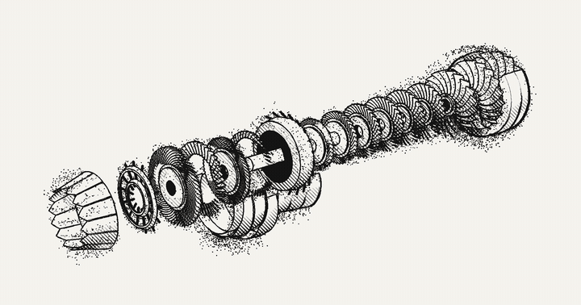

  

   
  

  
  

   

 

  <picture>
    <source
      srcset="https://raw.githubusercontent.com/d-exclaimation/d-exclaimation/output/github-contribution-grid-snake-dark.svg"
      media="(prefers-color-scheme: dark)"
    />
    <source
      srcset="https://raw.githubusercontent.com/d-exclaimation/d-exclaimation/output/github-contribution-grid-snake.svg"
      media="(prefers-color-scheme: light), (prefers-color-scheme: no-preference)"
    />
    
  </picture>

